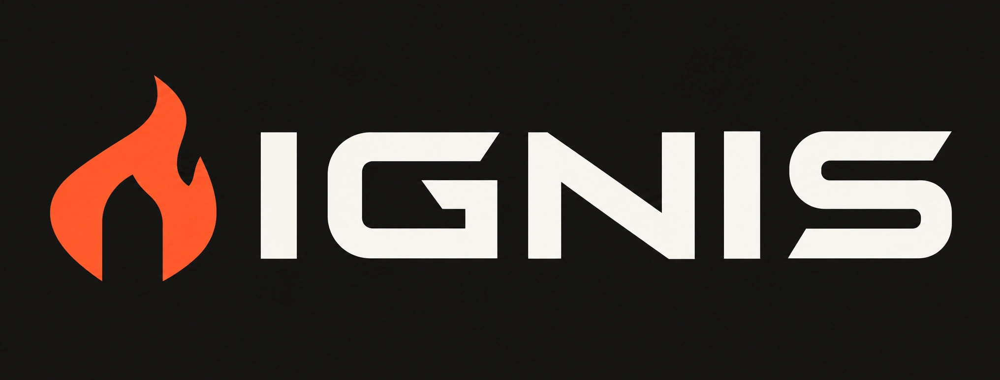
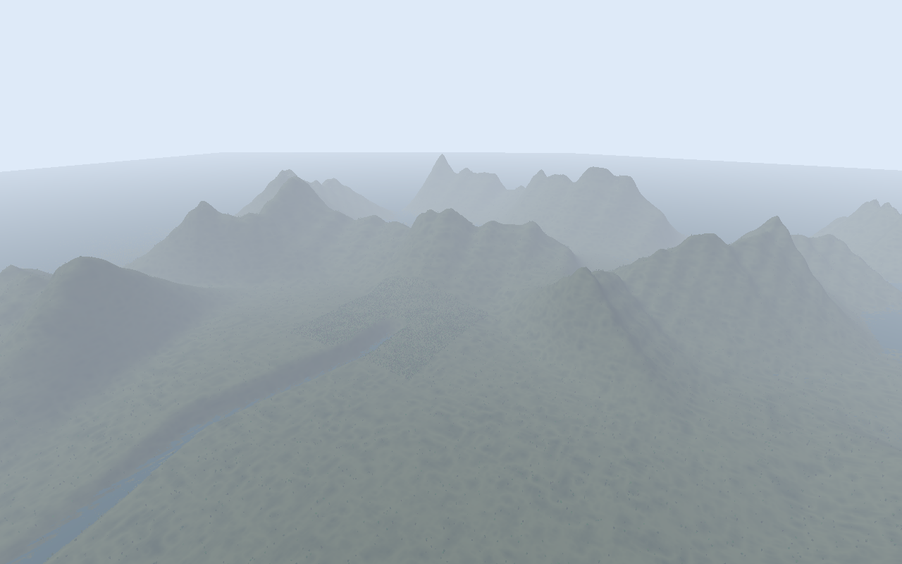
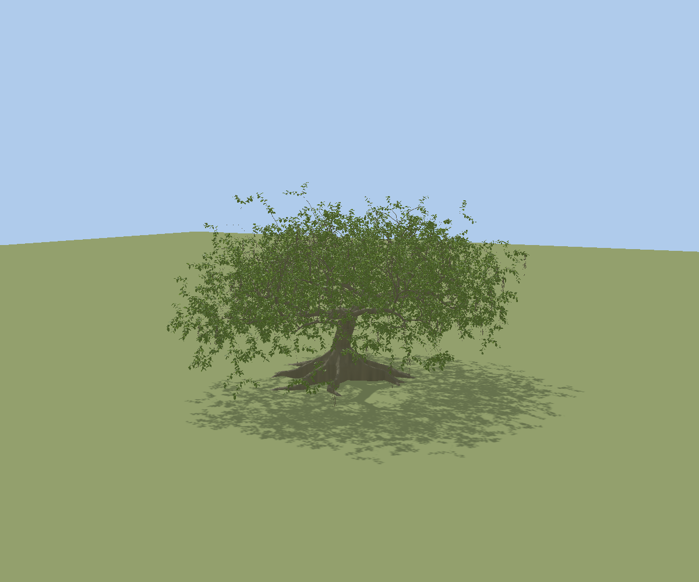
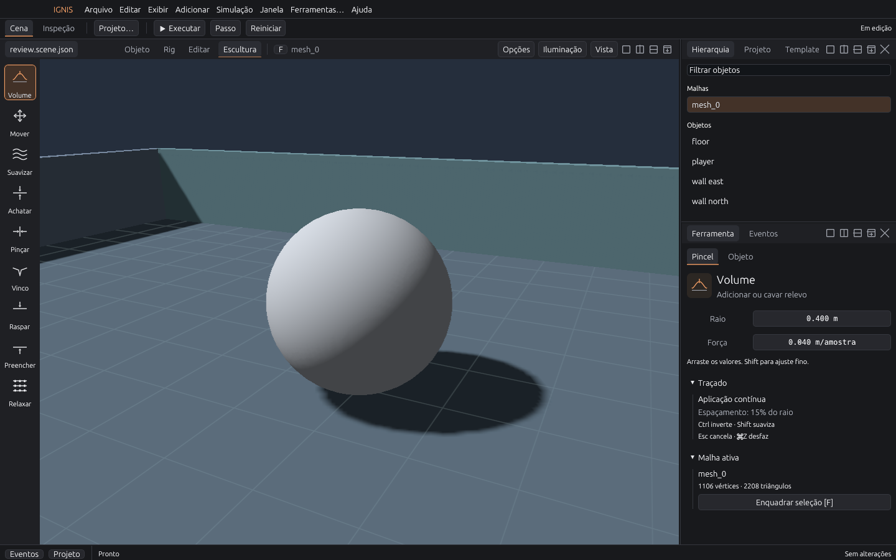

<div align="center">
  
  <h3>A 3D engine humans and AI agents can build in together.</h3>
  <p>Build → run → inspect → capture → refine. One command API. One world.</p>
  <p>
    <a href="https://github.com/zerobytes/ignis/actions/workflows/ci.yml"></a>
    <a href="LICENSE"></a>
    
  </p>
  <p><a href="docs/quickstart.md">Quickstart</a> · <a href="docs/status.md">What works today</a> · <a href="https://github.com/zerobytes/ignis/discussions">Discussions</a> · <a href="README.pt-BR.md">Português</a></p>
</div>


*Actual Ignis render from the expanded-world demonstration. This is the planar terrain demo; the experimental planetary runtime has separate visual limitations.*

Ignis is a source-available **Rust 3D engine with Model Context Protocol (MCP)
authoring and a native visual editor**. A human can edit a scene while an agent
uses typed commands to inspect it, change it, step the simulation and request
real rendered captures. Both operate through the same dispatcher.

The core runs **offline**. No cloud account, API key or LLM is required to run
the engine. Connect your own MCP client when you want agent assistance.

## Why Ignis?

- **A shared, inspectable world.** MCP and the native editor share the command
  API, validation and state. Agents receive structured results and real pixels.
- **Procedural content you can edit.** Terrain, botanical structures, meshes
  and character parameters have native authoring data, rather than only a
  flattened image or opaque generated asset.
- **Gameplay beyond rendering.** Physics, character controllers, NPC perception,
  memory, navigation, abilities and offline simulation are integrated.
- **Reproducible experiments.** Explicit state inspection, bounded operations,
  undo, persistence and build-scoped replay make failures easier to investigate.

**Early development:** this is a working research engine, with breaking changes
and substantial unfinished work. It is not a production-ready replacement for
established engines. Current desktop validation is centered on macOS Apple
Silicon; other platforms need independent validation. See [status and limits](docs/status.md).

## Try it

Install [Rust](https://www.rust-lang.org/tools/install) (1.88 or newer) and your
platform's native development tools. A compatible GPU is required for windows
and rendered captures; inspection and simulation can run headlessly.

```sh
git clone https://github.com/zerobytes/ignis.git
cd ignis
cargo build --locked --release

# Native editor with an included scene
./target/release/ignis --root "$PWD" --editor --scene examples/stealth-lab.scene.json
```

For a playable scene, use `--window` instead of `--editor`. **P** starts or pauses,
**WASD** moves, and **R** resets. [Setup, platform notes and troubleshooting →](docs/quickstart.md)

No GPU or MCP client is needed for this first inspection:

```sh
./target/release/ignis --root "$PWD" \
  --scene examples/stealth-lab.scene.json \
  --command '{"command":{"op":"inspect"}}'
```

## Connect an agent

Point any compatible **local stdio MCP client** at your build and project folder:

```json
{
  "mcpServers": {
    "ignis": {
      "command": "/absolute/path/to/ignis/target/release/ignis",
      "args": ["--root", "/absolute/path/to/ignis", "--mcp"]
    }
  }
}
```

Add `--editor` to those arguments to share the same process with the visual
editor. Without it, MCP runs headlessly. The client discovers the
`engine_command` tool and its generated schema through `tools/list`.

Try this prompt in your client:

> Inspect the scene first. Generate a small seeded room, run 120 simulation
> steps, capture the result and explain what changed. Ask before discarding
> existing edits.

An `engine_command` argument looks like this:

```json
{"command":{"op":"capture","path":"artifacts/view.png","width":1280,"height":900}}
```

Captures return actual engine PNG pixels and metadata. The engine is the tool;
the language model and its provider are your choice. [MCP walkthrough →](docs/quickstart.md#mcp-walkthrough)

## Explore the engine

Start with the [English architecture overview](docs/overview.md). The deeper
technical notes below are currently in Portuguese; English translations are welcome.

| Area | Start here |
| --- | --- |
| Editor, meshes and sculpting | [Editor](docs/editor.md) · [Modeling](docs/editor-modeling.md) · [Sculpting](docs/sculpt-brushes.md) |
| Procedural terrain and atmosphere | [Terrain](docs/terrain.md) · [Representative world](docs/representative-world.md) · [Atmosphere](docs/atmosphere.md) |
| Native botany | [Integration](docs/botany-integration.md) · [Architecture](docs/botany-architecture.md) · [Roots](docs/botany-roots.md) |
| NPCs, navigation and gameplay | [NPC capability matrix](docs/npc-v1-closure.md) · [Integrated demo](docs/npc-v1-demo.md) |
| Save, replay and networking | [Portable saves](docs/portable-saves.md) · [Optional QUIC transport](docs/quic-transport.md) |
| Engine architecture and API | [Architecture](docs/architecture.md) · [Command contract](docs/commands.md) · [Demo catalog (PT)](docs/demo-catalog.pt-BR.md) |

<table>
  <tr>
    <td></td>
    <td></td>
  </tr>
  <tr><td>Native procedural botany. Actual engine capture.</td><td>Native editor and sculpting tools. Actual editor capture.</td></tr>
</table>

Technical documents include historical milestones and their validation
boundaries, mostly in Portuguese. Generated test artifacts and private
reference inputs are not bundled. [Image provenance](docs/media/README.md).

## Help shape Ignis

The most useful first contribution is **trying the quickstart and reporting
exactly where it succeeds or fails**. Build fixes, clearer examples, docs and
MCP client interoperability reports are welcome.

Read [CONTRIBUTING](CONTRIBUTING.md), open a
[reproducible bug report](https://github.com/zerobytes/ignis/issues/new?template=bug_report.yml),
or share an experiment in [Discussions](https://github.com/zerobytes/ignis/discussions).
If you want to follow the work, star the repository or watch releases.

## License and credit

Created by **Guilherme Oliveira ([zerobytes](https://github.com/zerobytes))**.
This distribution uses the [Ignis Engine Commercial Source License 1.0](LICENSE).
It is **source-available, not OSI-approved open source**.

**Free to start. After a Game exceeds USD 1 million in lifetime revenue,
royalties are 1% of eligible profit, after eligible costs and unrecovered losses.**
The first million is exempt; there is no retroactive charge on exempt profit.
No eligible profit means no royalty. Proprietary games are permitted. Retain
[NOTICE](NOTICE) and the applicable license/attribution notices.

Read the [calculation examples and full policy](docs/licensing.md) and
[private reporting guide](docs/royalty-reporting.md). Third-party components
retain [their own licenses](THIRD_PARTY_NOTICES.md). Earlier Apache-2.0 grants
for previously published copies are not revoked by this repository replacement.
