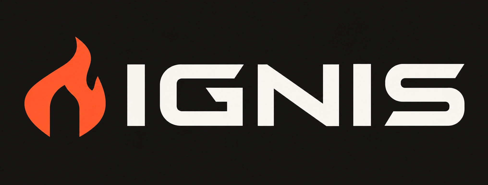
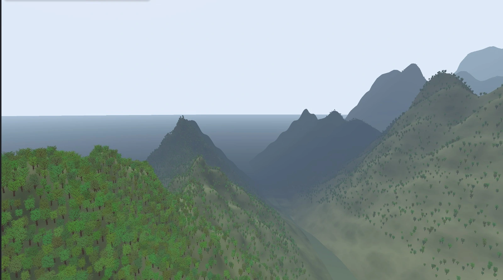
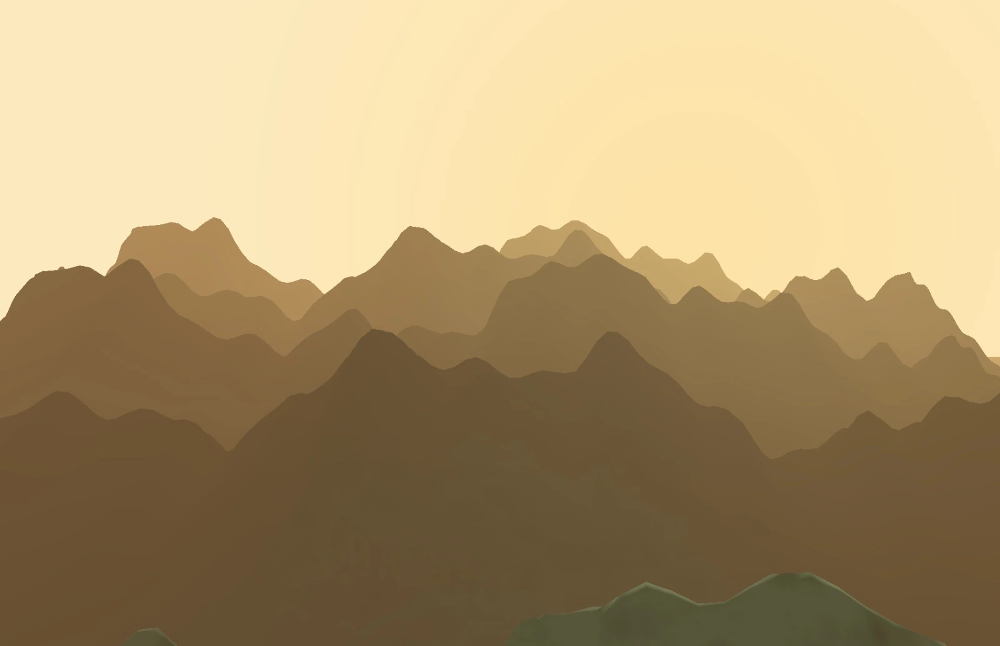
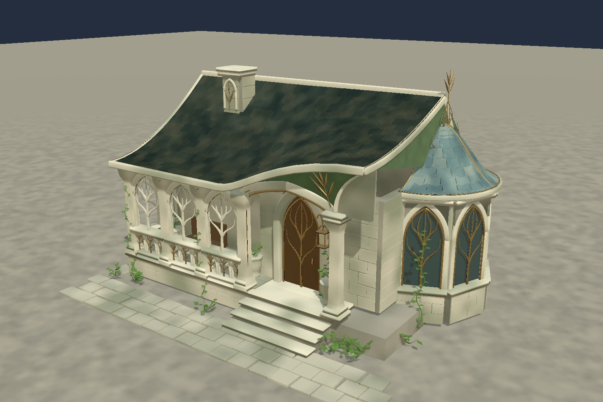

<div align="center">
  
  <h3>Uma engine 3D para humanos e agentes de IA construírem juntos.</h3>
  <p>Construir → executar → inspecionar → capturar → refinar. Uma API. Um mundo.</p>
  <p><a href="README.md">English</a> · <a href="docs/quickstart.md">Começar</a> · <a href="docs/status.md">Estado atual</a> · <a href="https://github.com/zerobytes/ignis/discussions">Comunidade</a></p>
</div>


***Ignis Horizon.** Vales, florestas e montanhas renderizados pela engine nativa. Captura selecionada pelo criador para o site.*

Ignis é uma **engine 3D com código disponível em Rust, com autoria via Model Context
Protocol (MCP) e editor visual nativo**. Humanos e agentes usam a mesma API de
comandos para editar, executar, inspecionar e pedir capturas reais da cena.

O núcleo funciona **offline**, sem conta, chave de API ou modelo de IA.
Você conecta seu próprio cliente MCP quando quiser trabalhar com um agente.

## O que existe hoje

- Editor nativo, modelagem, escultura e inspeção estruturada.
- Terreno, atmosfera, botânica e parâmetros de personagens com fontes editáveis.
- Física, controladores, percepção/memória/navegação de NPCs e habilidades.
- Undo, saves portáteis, replay restrito ao build e rede QUIC opcional.

**Desenvolvimento inicial:** a engine funciona, mas ainda tem mudanças
incompatíveis e trabalho substancial em aberto. A validação desktop está
concentrada em macOS Apple Silicon. Não há promessa de engine pronta para
produção, FPS universal ou suporte multiplataforma já aceito.
[Recortes e limites atuais](docs/status.md).

## Experimente

Instale Rust 1.88 ou mais recente e as ferramentas nativas de desenvolvimento.
Janelas e capturas exigem GPU compatível; inspeção e simulação podem rodar sem janela.

```sh
git clone https://github.com/zerobytes/ignis.git
cd ignis
cargo build --locked --release
./target/release/ignis --root "$PWD" --editor --scene examples/stealth-lab.scene.json
```

Troque `--editor` por `--window` para a demo jogável. **P** inicia/pausa,
**WASD** move e **R** reinicia. [Configuração e diagnóstico](docs/quickstart.md).

## Conecte um agente

Configure o cliente MCP stdio com caminhos absolutos:

```json
{
  "mcpServers": {
    "ignis": {
      "command": "/caminho/absoluto/ignis/target/release/ignis",
      "args": ["--root", "/caminho/absoluto/ignis", "--mcp"]
    }
  }
}
```

Acrescente `--editor` aos argumentos para compartilhar a mesma sessão com o
editor visual. A ferramenta `engine_command` expõe o schema real dos comandos.
Peça ao agente para inspecionar a cena, construir um exemplo pequeno, executar
passos e capturar o resultado antes de propor a próxima alteração.

Os [exemplos e links por área estão no README principal](README.md#explore-the-engine).
Há também um [catálogo de demos em português](docs/demo-catalog.pt-BR.md).

## Capturas da engine

<table>
  <tr>
    <td></td>
    <td></td>
  </tr>
  <tr><td>Silhuetas de montanhas e camadas atmosféricas. Captura nativa.</td><td>Estudo de arquitetura. Captura nativa da Ignis.</td></tr>
</table>

## Participe e acompanhe

Experimente o início rápido e relate o primeiro ponto que falhou, com ambiente
e comando exato. Melhorias de build, exemplos, documentação e integração MCP
são bem-vindas. Leia [CONTRIBUTING](CONTRIBUTING.md), abra uma
[issue](https://github.com/zerobytes/ignis/issues/new/choose) ou compartilhe sua
experiência em [Discussions](https://github.com/zerobytes/ignis/discussions).
Uma estrela ajuda quem quer acompanhar o projeto.

## Licença e autoria

Criado por **Guilherme Oliveira ([zerobytes](https://github.com/zerobytes))**.
Esta distribuição usa a [Ignis Engine Commercial Source License 1.0](LICENSE):
código disponível sob licença comercial, **não open source nos termos da OSI**.

**Grátis para começar. Depois de US$ 1 milhão de faturamento acumulado por jogo,
a participação é de 1% do lucro elegível, após custos elegíveis e prejuízos não
recuperados.** O primeiro milhão é isento, sem cobrança retroativa sobre o lucro
isento. Sem lucro elegível, não há royalty. Jogos proprietários são permitidos.

Preserve [NOTICE](NOTICE), a licença e os avisos de autoria aplicáveis.
Leia a [política e os exemplos de cálculo](docs/licensing.md) e mantenha
[relatórios financeiros privados](docs/royalty-reporting.md). O texto inglês
controla. Terceiros mantêm [suas licenças](THIRD_PARTY_NOTICES.md). A substituição
do repositório não revoga direitos Apache-2.0 de cópias publicadas anteriormente.
