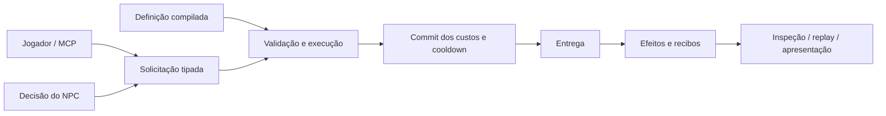

# Habilidades compartilhadas — estudo e proposta (EAF-37)

Status posterior: o usuário autorizou o recorte A; contrato implementado em [abilities.md](abilities.md), EAF-38. As propostas abaixo preservam o registro do estudo anterior à implementação.

**Estado: proposta de contrato para revisão técnica.** Este estudo não acrescenta habilidades ao runtime da Ignis, não escolhe ABI de extensões e não altera cena/replay25. O rádio EAF-36 recebeu aceite humano explícito. Rampas/controlador continuam adiados. Objetivo desta etapa: preparar a próxima dependência dos NPCs com evidência da abstração que já existe em LandOfChaos.

## 1. Referência e limite da evidência

Referência consultada em 24/10/2026: LandOfChaos, revisão **7b978932c0428b9b8f3691f5edb73226e49fac89**, no checkout local `/Volumes/Zero/EpicGames/Unreal Projects/LandOfChaos`. A pasta land-of-survivor contém material relacionado; o runtime consultado está no projeto Unreal. O [inventário](ability-reference-inventory.json) registra 16 arquivos, hashes e correspondência com o checkout no instante da leitura. Alterações paralelas de arte foram preservadas; nenhum arquivo do projeto de referência foi modificado, compilado ou executado.

Os números do relatório histórico ABILITY_ENGINE_VALIDATION.json são **auditoria de autoria**: 294 programas válidos (10 exemplos e 284 adaptações), 1.103 etapas e 1.005 ações. O próprio relatório declara actions_executed=false e gameplay_world_started=false. Isso comprova construção/validação dos dados naquele registro; não é evidência de 294 habilidades jogáveis, testes feitos neste estudo ou paridade futura da Ignis.

Na Ignis, a base consultada é a65f68a: Rust, simulação fixa60Hz, documento de cena separado do estado, dispatcher MCP compartilhado, percepção limitada, objetivos e navegação com replay. Não há ainda catálogo/runtime de habilidades, recursos genéricos, morte ou execução de efeitos.

## 2. O que a implementação de referência ensina

Caminhos abaixo relativos à revisão de LandOfChaos. Prefixo A = Source/LandOfChaos/LoS/Abilities.

| Responsabilidade | Evidência de implementação | Consequência para Ignis |
|---|---|---|
| Definição e execução separadas | A/LoSAbilityProgram.h: enums de seleção, ativação, gatilho, forma, viagem, colisão, custos e etapas; LoSAbilityExecution.cpp: Start/Execute/Finish | Uma definição compartilhada e instâncias de execução por ator; dados de autoria não guardam cooldown ou progresso. |
| Composição independente do nome da magia | Program tem seleção, lifecycle, custos, etapas, ações e cues; LoSAbilityExamples.cpp combina cura canalizada, flecha carregada, zona após arco e recarga | Não criar um enum Fireball/Heal/Teleport. Operações e entrega devem ser peças independentes. |
| Custos múltiplos e sobrepostos | Execution.cpp: ReserveCosts, CheckCosts, CheckInitialCosts | Somar/reservar todos os débitos de uma fase antes de cobrar; dois custos no mesmo recurso não podem passar isoladamente e exceder o saldo juntos. |
| Custos dependentes do instante | CheckInitialCosts simula Start+Execute sem cobrar; ConsumePhase cobra Start/Execute/Pulse/Release conforme lifecycle | Pré-checagem não é reserva persistente: o saldo pode mudar durante cast. Política de revalidação e reembolso precisa ser explícita. |
| Instância pode terminar antes da entrega | Execution.cpp: Finish, MaybeDestroy; StageActor.cpp: OnExecutionEnded | Projétil já lançado pode sobreviver ao fim do cast; aura ligada ao canal pode terminar junto. Dono e duração não são a mesma coisa. |
| Contato físico e elegibilidade separados | Targeting.cpp: AllowsContact versus IsEligible; StageActor.cpp: SweepTravel | Algo pode bloquear um projétil sem receber seu efeito. Facção não transforma automaticamente um corpo em transparente. |
| Efeito retorna resultado aplicado | Actions.cpp: Vital/Attribute; LoSAbilityEffectOutcome.h; LoC/LoCAttributeSet.cpp: OwnHealthDelta | Roubo de vida e reações usam o dano efetivamente aplicado; não multiplicam novamente o dano pretendido ou um delta contaminado por callbacks. |
| Extensão e apresentação | Actions/Conditions são UObjects; ComposedGameplayAbility usa GAS, montage/cues; InputComponent faz grant/press/release/cancel | Aprender a fronteira modular; não copiar o acoplamento Unreal/GAS/Blueprint ou assumir que esse é o contrato multiplataforma da Ignis. |
| Proteções contra encadeamento sem limite | Execution.cpp limita DispatchDepth, MaxStageActivations, MaxConcurrentStages; Events.cpp limita recursão a16 | Qualquer encadeamento futuro terá orçamento e motivo de falha inspecionável; limitar somente tempo de parede não basta para replay. |
| Regras particulares continuam particulares | Actions.cpp/Targeting.cpp consultam LoCAttributeSet e personagem; LegacyAdapter trata dash/knockback/revive | Health, Mana, equipes, ressurreição e controlador do jogo não devem se tornar dependências ocultas do núcleo de habilidades. |

A referência usa instâncias Actor, timers em segundos, TArray/TMap/TSet, efeitos GAS transitórios e chamadas síncronas. Isso pode ser adequado naquele ambiente, mas não constitui um núcleo Rust portável. Probability usa FMath::FRand; empates de consulta usam GetUniqueID. Não há neste estudo prova de reprodução dessas escolhas entre execuções. A Ignis precisa definir semente, ordem estável e armazenamento próprios quando essas funções entrarem.

## 3. Alternativas estruturais

| Alternativa | Benefício | Custo/risco |
|---|---|---|
| Portar agora o grafo inteiro de etapas/eventos | Expressividade próxima da referência desde o começo | Exige scheduler, efeitos persistentes, tags, consultas, ciclos, lifetime e orçamento antes do primeiro NPC executar uma ação; alto custo de contrato. |
| Uma classe/função por habilidade nomeada | Demonstração muito rápida | Duplica custos, alvos e cancelamento; pouca composição/proceduralidade e uma API por habilidade. |
| **Definições tipadas com operações pequenas e executor comum** | Contratos limitados, inspecionáveis, compiláveis para dados compactos; jogador/NPC compartilham execução | Conjunto inicial fechado de operações; adicionar comportamento exige evolução versionada até existir fronteira de extensão. |
| Scripts/Wasm desde a primeira ação | Extensão por diferentes linguagens mais cedo | Escolha antecipada de VM/ABI, memória, permissões, fuel, aleatoriedade e serialização de continuations. Precisa de decisão própria. |

**Recomendação:** terceira alternativa. Preservar a separação conceitual definição → solicitação → execução → entrega → efeito → resultado. Começar com entrega direta e operações instantâneas tipadas; não construir um grafo genérico nem publicar uma ABI antes de validar o fluxo. O formato de autoria é contrato do produto; os índices/layouts compilados continuam internos. A futura extensão poderá produzir as mesmas solicitações autorizadas, mas sua linguagem/ABI permanece aberta.

## 4. Contrato mínimo proposto

Nomes abaixo são propostas, não comandos já disponíveis.

- **AbilityDefinition:** ID estável, seleção permitida, alcance/relações, cast_ticks, cooldown_ticks, lista de custos, entrega direta e lista de efeitos. Definições imutáveis durante uma partida neste primeiro recorte; editar cena reinicia como já acontece.
- **AbilityGrant:** ator pode usar uma definição num slot; conceder não cria uma instância ativa. Jogador/NPC têm o mesmo grant/runtime.
- **AbilityRequest:** ator, slot, seleção tipada, tick e sequência. Receber pelo MCP não aplica efeitos imediatamente: coloca uma entrada para o próximo passo.
- **AbilityExecution:** ID monotônico da execução, origem da solicitação, ator, definição compilada, seleção, started_tick, execute_at e resultado. Uma execução de cast por ator no primeiro recorte; cooldown por grant.
- **EffectReceipt:** execução/ator/efeito, destinatário, tick, quantidade solicitada, quantidade aplicada e motivo. Recibo é observabilidade; não dispara callbacks arbitrários nesta versão.

Estado mínimo: solicitação rejeitada ou casting → committed/completed; casting pode virar cancelled/failed. Cooldown é um prazo separado, não uma execução que ocupa o ator inteiro. Uma habilidade instantânea com cast_ticks=0 pode completar no tick de consumo. Cast começado em t com duração30 faz commit em t+30, nunca30 frames renderizados.

### Recursos e representação numérica

Recursos são um catálogo autorado, com IDs como energia, foco ou munição; ator declara quais possui, saldo inicial e capacidade. Nenhum campo Mana obrigatório. Tipos de recurso podem ser acrescentados por dados, dentro de limites de armazenamento declarados, sem editar Rust para cada energia.

Recomendação: **unidades inteiras em i64, não negativas para saldo/capacidade**, com escala de apresentação por recurso. Exemplo: scale=1000, amount_units=1250 representa1,25 unidades visíveis. Custos e deltas usam unidades inteiras explícitas no contrato; nenhuma conversão silenciosa de decimal por truncamento. Limite inicial proposto de10^12 unidades por saldo/custo/delta, operações checked e validação dos intermediários.

| Opção | Tradeoff |
|---|---|
| f32 | Combina com grande parte da física; valores fracionários simples. Arredondamento influencia saldo suficiente/insuficiente após muitas operações. |
| Inteiros e escala explícita | Débito/comparação exatos nessa representação; replay econômico simples. Autor precisa escolher granularidade; multiplicadores exigirão política de arredondamento. |
| Tipo numérico configurável por recurso | Mais flexível, mas cria coerção e variantes no caminho quente e no schema antes de haver necessidade comprovada. |

A escolha não implica ganho de FPS medido. Posições/alcance continuam f32 como a física. Recursos não são atributos arbitrários: velocidade, multiplicadores, resistências e modificadores temporários precisam de contrato próprio. Vida também não será apenas “um recurso chamado health”: zerar vida terá efeitos em percepção, ação, navegação, colisão e respawn. Dano/cura entram quando esse ciclo estiver definido.

### Custo, capacidade e atomicidade

Primeiro recorte: uma única fase de cobrança, **no commit**. Durante cast, a checagem inicial informa viabilidade, sem reservar saldo. No commit, revalidar grant, alvo, alcance, linha de visão, condições e saldos; agregar custos repetidos, preparar os efeitos e reservar os slots necessários. Só então efetivar débitos, efeitos imediatos e cooldown como uma transação limitada daquele commit.

Exemplo: energia8, custos energia5 + energia4 → rejeição sem cobrar5. Energia10 e foco2, custos energia6 + foco3 → rejeição sem cobrar energia. Efeitos que repõem energia não financiam os próprios custos: primeiro validar débitos sobre o estado pré-commit.

Cancelamento/falha antes do commit: nenhum débito e nenhum cooldown nesta primeira política. Commit concluído não é desfeito por cancelamento tardio. Para recursos, aplicar deltas em ordem autorada com clamp0..capacidade e registrar o delta real. Efeito sem capacidade de produzir alteração é no_effect, não erro de transporte; consome custos se o commit era válido. Para evitar desperdício, o autor pode declarar condição de saldo antes da execução. Uma operação inválida por ausência de recurso ou referência rejeita o commit inteiro.

Não estender essa atomicidade automaticamente a projéteis, DoT, spawn ou ações externas. Quando entregas persistentes entrarem, lançamento pago e impacto posterior poderão falhar sem reembolso; rollback de mundo não é a abstração sugerida. Custos em Start/Pulse/Release, reservas duradouras, fallback e reembolso configurável ficam para a evolução do contrato.

### Conhecimento e alvos

A seleção não é uma consulta onisciente embutida. ActorRef significa identidade; KnownPoint significa coordenada conhecida congelada. Observação de outro NPC, rádio e som continuam com a proveniência já existente.

No primeiro recorte, self e actor são suficientes. Solicitações de NPC para actor exigem observação visual confirmada atual do alvo no snapshot de sensores, tanto na aquisição quanto no commit. Alvo por rádio/memória não autoriza resolução da posição oculta. NPC com política explicitamente onisciente mantém a exceção declarada. Filtro de relação da habilidade é separado do sensor: visão de alvo aliado explícito já é possível, mas seleção automática atual só procura hostis; não alegar suporte automático a médicos escolhendo aliados feridos.

MCP/humano pode indicar ID de ator, mas o executor aplica alcance/linha de visão/relações. O comando não pode marcar uma solicitação de NPC como “visão confirmada”; essa proveniência vem internamente dos sensores. Falhas entregues à decisão devem ser genéricas quando detalhamento expuser um alvo oculto; diagnóstico privilegiado pelo MCP pode ser mais completo.

No futuro, Point/Direction permitirão atirar no último local conhecido. Isso usa a coordenada congelada e pode acertar ou errar fisicamente. Homing exigirá um sensor ou vínculo explícito de acompanhamento; importar a leitura contínua do ator da referência concederia rastreamento implícito.

### Relação com objetivos, movimento e interrupção

Adicionar ação de objetivo use_ability é uma proposta, consumindo somente uma seleção permitida e condições de recursos próprios. O mesmo executor atende comando humano, MCP e decisão autônoma. A lógica de efeito não fica no NPC nem no controle do jogador.

Desativar npc.enabled suprime decisões automáticas; no contrato proposto também cancela cast iniciado pelo seletor. Controle explícito via MCP continua distinguível na origem e não recebe permissões sensoriais extras. Remover grants por edição segue reset da partida neste recorte, sem promessa de hot reload de uma execução.

Enquanto uma habilidade está em cast, o seletor precisa distinguir “em execução” de “concluída/falhou”, suspender a rotina e retomar por resultado. Reavaliação não pode reiniciar o cast a cada tick. Cooldown impede nova tentativa; falha usa retry_ticks limitado, sem gerar uma solicitação/recibo por frame indefinidamente. Interrupção de objetivo cancela apenas o cast ainda não comprometido; política exata de prioridade permanece no seletor existente.

Primeiro recorte usa habilidades que permitem movimento. Não introduzir “parar o corpo” como efeito genérico: voo sem hover, salto comprometido e guarda de passagem têm contratos próprios. Cast que exige imobilidade, root, dash, knockback e animação precisam discutir quem controla o motor, especialmente após o estudo de rampas/controlador.

## 5. Ordem de simulação e reprodução

Proposta a validar na implementação:

1. Congelar posições pré-física e consumir comandos externos destinados ao tick t. Cancelamentos aplicáveis são resolvidos antes de commits vencendo no mesmo tick; cancel+activate não permite reiniciar o mesmo ator nesse tick.
2. Executar percepção com ruídos manuais e ruídos automáticos de t-1. Decisões de todos os NPCs leem o mesmo snapshot de recursos/percepção antes de qualquer habilidade modificar saldos.
3. Produzir intenções de NPC. Para um mesmo ator, solicitação externa explícita tem precedência sobre a automática; uma só solicitação nova pode vencer por tick.
4. Avançar casts existentes; processar commits em ordem estável (actor ID, execution ID). Depois, aceitar novas solicitações em ordem estável (actor ID, request sequence). Assim uma habilidade instantânea recém-pedida não cancela retroativamente um commit já vencido.
5. Cada commit vê o estado deixado pelos commits anteriores. Conflitos de saldo/efeito são serializados nessa ordem, não por ordem de ponteiros ou chegada de callbacks. Inspeção registra a ordem. Isso é determinismo serial, não justiça entre atores nem simultaneidade física.
6. Aplicar navegação/motores e física. Ruídos de habilidades tornam-se audíveis no tick seguinte, com emissores identificados para autoexclusão, como passos; não voltam a alimentar decisão no mesmo tick.

O primeiro incremento sem rádio/habilidades ativas deve conservar a sequência atual dos demais sistemas. Caso seja necessário mudar a ordem de aplicação do input físico para implementar cancelamento, a alteração deve ser explícita e testada; não assumir que esse diagrama já é o runtime atual.

Replay deve registrar inputs externos de ativar/cancelar com tick/seq, inclusive comandos pendentes no prefixo. Ações autônomas de NPC são regeneradas, não reproduzidas uma segunda vez de um log de efeitos. Estado esperado inclui recursos, casts, cooldowns e ruídos pendentes. Editar/reset/load/undo recompila catálogo e limpa instâncias; salvar cena continua salvando autoria, não checkpoint de partida. Replays antigos seguem a política de versão/build existente. Determinismo de recursos não promete determinismo físico entre plataformas.

## 6. Interface e limites propostos

Operações compartilhadas, disponíveis no MCP antes de qualquer atalho/botão:

| Operação proposta | Contrato |
|---|---|
| set_ability_catalog / edit_scene | Definições e recursos validados em conjunto; referências/grants consistentes e undo único. |
| upsert / edit_scene | Recursos iniciais e grants por ator, além da política de objetivo NPC. |
| activate_ability | Enfileira uma solicitação validada estruturalmente; retorna request_id/tick. Aceita na fila não significa habilidade executada. |
| cancel_ability | Solicita cancelamento por execution_id, evitando cancelar uma nova instância no mesmo slot por engano. |
| inspect_abilities / inspect_resources | Configuração, saldo, prazo, estado, resultado, fila pendente e recibos recentes; sem depender de render. |
| step / capture / replay | Operações atuais ampliadas para observar a mesma execução e reproduzir o resultado. |

Falha de schema/revisão/limite de fila é erro atômico de comando. Rejeição de gameplay como insufficient_resource, cooldown, busy, target_unavailable ou out_of_range é resultado estruturado da solicitação consumida. Não usar mensagem textual como protocolo de decisão.

Limites iniciais propostos, não garantia de escala:64 definições,32 tipos de recursos na cena,16 recursos por ator,16 grants por ator,8 custos e8 efeitos por definição; uma execução por ator,16 solicitações externas por tick e256 recibos recentes no mundo. Mantém o limite atual de8 NPCs/9 atores. IDs viram índices na compilação da cena; slots de execução/recursos são alocados uma vez. Anel de recibos pode sobrescrever os mais antigos com contador explícito; fila de trabalho não descarta silenciosamente ações. Saturação rejeita antes do débito.

Render inicial pode mostrar cast/resultado por guias e seleção, com os mesmos toggles MCP. Não adicionar avatar/animação/áudio como dependência artificial deste primeiro contrato. Formatos de cache/binário e ABI pública não são necessários para manter JSON fora do caminho de execução: já decodificamos autoria/comandos na fronteira.

Proceduralidade: catálogo/grants/perfis podem ser produzidos por receita parametrizada via MCP e salvos como conteúdo normal. Não inferir comportamento pela string do ID. Sorteio de efeitos/variações em runtime fica para etapa que defina stream de RNG por execução e seed registrada; o primeiro recorte não precisa de aleatoriedade.

## 7. Primeiro incremento jogável recomendado

**Recorte A: ações diretas com cast, múltiplos recursos e cancelamento.** Sem dano, morte, canalização, projéteis, buffs persistentes, grafo de eventos ou scripting.

Três definições compostas dos mesmos operadores (ajuste de recurso e emissão de ruído), sem código por nome:

1. Converter: self, cast30 ticks, custa2 foco +1 vigor, acrescenta4 carga, cooldown60. A mesma definição é concedida ao jogador e a um NPC; a decisão do NPC usa recursos próprios.
2. Energizar: actor aliado, cast45 ticks, custa5 carga, acrescenta4 carga ao destinatário, alcance6m e linha de visão obrigatória, cooldown90. O aliado usa alvo explícito observado, sem varredura de recursos ocultos.
3. Sinalizar: self, cast0, custa1 carga, emite ruído de raio12m a partir do emissor, cooldown60. Outro NPC com audição reage no tick seguinte. É habilidade não combativa usando um sistema já funcional.

Os valores são fixtures propostas, não balanceamento ou configs já implementadas. Demo autorada via MCP com P/R/V/H e controles de ativar/cancelar quando houver paridade. HUD ou guias devem permitir verificar o cast e o resultado; logs JSON sozinhos não encerram o aceite humano.

Depois de A: definir vida/morte e resolução de dano/cura; depois entrega física/projéteis, área e efeitos persistentes. Um projétil curativo e um danoso devem compartilhar a entrega, e o mesmo efeito deve funcionar em entrega direta e física. Só então detalhar composição por eventos, canais, cargas, tags/regras avançadas e extensões. Isso não reordena sozinho todo o roadmap; são dependências propostas para discussão.

## 8. Casos de aceitação antes de declarar A pronto

- Jogador e NPC, mesma definição/grant, mesmas condições: custos, prazos e recibos equivalentes; só muda a origem do input.
- Débito simultâneo de dois recursos; custos duplicados no mesmo recurso; insuficiência de um; overflow; limite de fila/recibo; alvo sem recurso. Falha não deixa cobrança parcial.
- Cast0 e cast30; cancel antes do prazo, cancel no tick do commit, cancel após commit e repetição do cancel. Nenhuma dupla execução.
- Saldo muda durante cast por outra habilidade; commit revalida. Não financia custos com próprio efeito. Recurso quase cheio registra o ganho limitado real.
- Alvo sai do alcance, fica oculto, muda de relação por edição ou é removido; contratos de edição/reset/grant e falha de execução distintos.
- NPC recebe relato de rádio mas não vê alvo: não ativa actor com coordenada oculta. Dois mundos com movimentos ocultos diferentes e mesmas pistas produzem as mesmas intenções/recibos permitidos.
- Objetivo interrompe/retoma; cooldown e retry impedem spam/reinício por tick; voo/salto comprometidos não são congelados.
- Duas ações no mesmo tick: ordem estável e resultado documentado, independente da ordem física de entidades no arquivo. Sem cadeia infinita de ruídos/efeitos.
- Save/load de autoria, edição inválida atômica, undo/redo/reset; replay final/prefixo com cast e solicitação pendentes, captura consistente.
- Checklist estático antes/depois, Rust e regressão MCP headless; demonstração visual e aceite humano separados. Nenhuma necessidade de foreground para validação.

## 9. Decisões para a próxima rodada

Recomendação pronta para revisão: definições tipadas e executor comum; recursos por unidades inteiras/escala; cobrança e cooldown no commit; uma ação em cast por ator; entrega direta antes de grafo/projéteis; nenhuma seleção oculta implícita.

São escolhas de contrato, com tradeoffs acima, e ainda não código entregue. Especialmente números, política de cobrança e concorrência merecem alinhamento antes de congelar o primeiro schema. Estudar a referência e recomendar essas escolhas não constitui aprovação de uma ABI, de multiplayer ou de combate completo.
