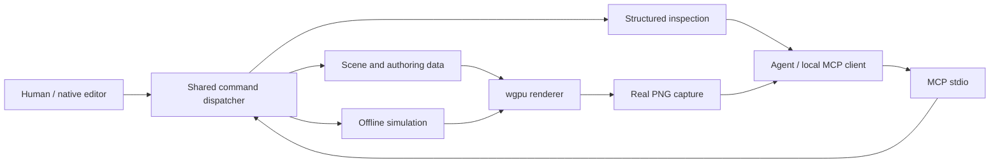

# How Ignis fits together

Ignis is a Rust library and desktop executable. Its central design is a shared,
typed command dispatcher: the visual editor and an MCP client work through the
same engine operations, validation and state transitions.

An agent is an optional external client, not a requirement of the engine. The
core does not need an account, API key, network server or language model for
local simulation. A user chooses their client and model independently.

## One process, one session

Run `ignis --mcp` for a headless command session. Run `ignis --mcp --editor`
for the same command session with the native editor attached. Starting two
processes creates independent sessions; they do not automatically synchronize.

Inspection reveals the current state. Edits can use `expected_revision` to
reject stale assumptions. Operations with undo, previews or confirmation have
explicit contracts; clients should discover and follow the current schema.
Captures are rendered from engine state, rather than generated by a model.

## Authoring data and runtime data

The scene stores authored entities, meshes, materials and configuration.
Procedural sources describe editable construction data for their supported
families: terrain, botanical structures and character parameters, for example.
The runtime evaluates behavior, physics, player input, perception and gameplay.
The renderer presents the current state through wgpu.

These layers have separate limits. A procedural source's authoring quota is
not a sustained simulation capacity or a frame-rate guarantee. Likewise,
successful serialization is not proof of artistic quality or native UI input.

## Build, inspect and refine

1. Inspect the scene before changing it.
2. Submit a small, typed edit and examine its result.
3. Step a paused simulation when a controlled experiment is useful.
4. Request a capture and compare the actual pixels with the intended outcome.
5. Refine, undo or save through the applicable command contract.

The [quickstart](quickstart.md) walks through this loop. The MCP `tools/list`
response provides the generated schema for `engine_command`; it is the best
starting point for client interoperability.

## Persistence and optional networking

Scene files, replay logs, native physics checkpoints and portable saves serve
different purposes. Replays are scoped to the build that produced them. A
native physics checkpoint is not a universal portable format. Portable saves
reconstruct runtime state through their own validation contract.

Networking is an explicit opt-in QUIC/TLS host/client path. Local single-player
does not start a remote server automatically. Loopback load experiments do not
establish WAN quality or production-scale MMO readiness.

## Read the code

| Entry point | Role |
| --- | --- |
| `src/main.rs` | CLI modes and process setup |
| `src/mcp.rs` | Newline-delimited MCP JSON-RPC transport |
| `src/engine.rs` | Typed commands, engine state and dispatcher |
| `src/service.rs` | Project-root services, files and capture operations |
| `src/botany/`, `src/terrain/`, `src/planet/` | Native procedural source families |
| `src/physics/`, `src/network/` | Physics adapters and optional transport |
| `tests/` | Integration and state-contract regressions |
| `scripts/run_verifications.py` | Selected end-to-end MCP regression runner |

Some technical notes and source comments are in Portuguese. The public README,
quickstart, contribution guide and this overview are maintained in English;
[README.pt-BR.md](../README.pt-BR.md) is an explicit Portuguese alternative.
See [current status](status.md) for the practical validation boundaries.
