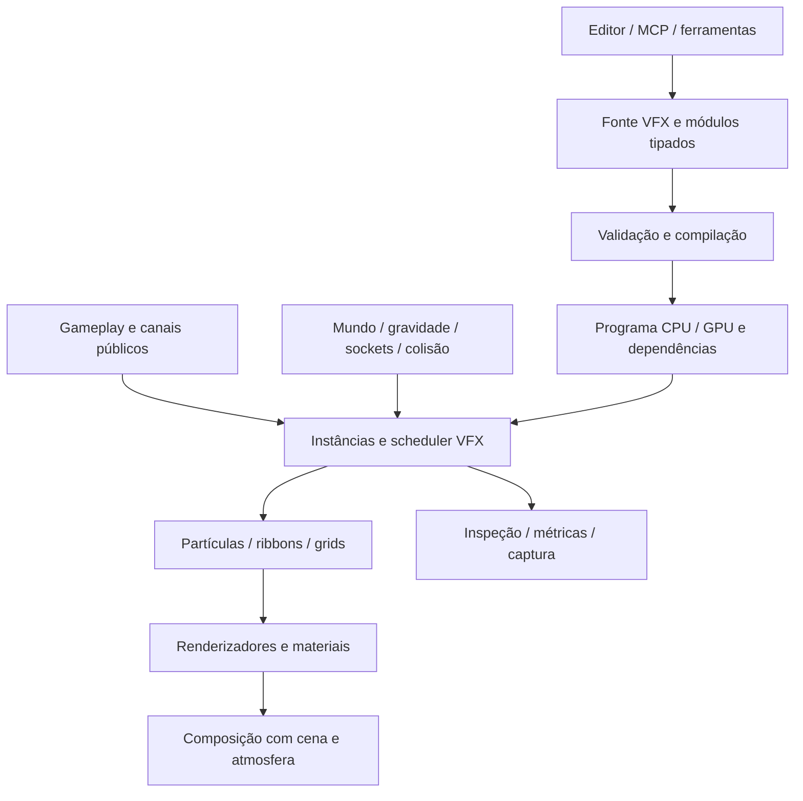

# Sistema de partículas e VFX — levantamento EAF-201

Proposta de requisitos, 03/11/2026. Pedido: criar efeitos de propósito geral,
com ambição comparável ao Niagara da Unreal. Este levantamento não implementa
o sistema nem certifica paridade, desempenho ou qualidade artística.

Continuidade autorizada em 03/11: iniciar pelo alicerce geral de materiais e
transparência, incluindo vidro e usos em outros sistemas, antes de emissores.
Contrato de implementação separado em [materiais/transparência — EAF-203](material-transparency.md).

Continuidade seguinte: espelhos adiados por decisão do usuário; iniciar agora
o [núcleo nativo de partículas — EAF-212](particles.md) sobre os materiais comuns.

## 1. Resultado esperado

Um artista, desenvolvedor ou agente deve conseguir criar, combinar, parametrizar,
executar e depurar efeitos inteiramente no Ignis. O conteúdo permanece editável,
reutilizável, procedural quando desejado e utilizável offline, sem depender do
agente que o criou. Iniciantes partem de presets; usuários avançados criam módulos
e comportamentos novos sem modificar o núcleo a cada efeito.

“Nível Unreal” significa amplitude de expressão, ferramentas de autoria,
integração e controle de custo. A referência funcional é Niagara; compatibilidade
com arquivos, módulos ou shaders da Unreal exigiria outro contrato. “Todo tipo”
orienta uma arquitetura extensível e um corpus representativo de efeitos, com
capacidades e limites declarados por implementação.

Na referência, sistemas, emissores, módulos e parâmetros são unidades de
composição; a autoria inclui timeline e módulos personalizados. Esses conceitos
fundamentam a proposta, sem exigir cópia da interface da Epic.
[Referência: Niagara Overview](https://dev.epicgames.com/documentation/en-us/unreal-engine/overview-of-niagara-effects-for-unreal-engine).

## 2. Famílias de efeitos que o sistema completo deve atender

| Família | Exemplos de demonstração | Capacidades necessárias |
| --- | --- | --- |
| Combustão | Tocha, fogueira, incêndio, explosão | Emissão, turbulência, emissivo, fumaça, brasas, iluminação opcional |
| Atmosféricos | Poeira, névoa localizada, cinzas, pólen, nuvens locais | Sprites suaves, volumes, campos de vento, composição com atmosfera |
| Clima | Chuva, neve, granizo, tempestade | Regiões móveis, abrigo/colisão, respingos, orçamento espacial |
| Magia | Aura, portal, feixe, raio, escudo, projétil | Múltiplos emissores, ribbons, meshes, distorção, parâmetros de gameplay |
| Impacto e destruição | Faíscas, sangue, cascalho, estilhaços | Normal/material do impacto, colisão, meshes, marcas na superfície |
| Movimento | Rastro de espada, trilha de projétil, propulsor | Amostragem de movimento, sockets, continuidade, quebra por teleporte |
| Água e líquidos | Spray, cachoeira, respingo, onda local | Sprites/meshes, reflexão/refração quando suportadas, solvers dedicados |
| Energia e tecnologia | Holograma, laser, eletricidade, dissolução | Materiais animados, feixes, curvas, campos, vínculos a superfícies |
| Ambiente vivo | Folhas ao vento, insetos, vaga-lumes | Instancing, orientação, campos, respostas locais e escalabilidade |

Cada família pode ter variantes realistas e estilizadas. Sangue ou fogo visual
não altera gameplay por si só; relações com dano, calor, molhamento, destruição
ou acúmulo persistente precisam de sistemas e vínculos explícitos.

## 3. Base atual e lacunas verificadas

Inspeção do checkout em `612e752`, com alterações paralelas de groundcover
preservadas. O inventário é dirigido aos pontos de integração, não uma auditoria
de toda a engine.

| Área | Base observada | Trabalho necessário para VFX |
| --- | --- | --- |
| Runtime | Rust, comandos compartilhados e inspeção MCP/editor | Domínio próprio de assets, instâncias e simulação de efeitos |
| GPU | wgpu 27; geometria compartilhada e caches de residência | Buffers de partículas, execução compute, geração de draws e recursos próprios |
| Composição | Pipeline principal com `blend: None`, depth write e alpha final 1 | Transparência, ordenação e composição com profundidade/atmosfera |
| Materiais | Receitas procedurais de superfície e resposta de iluminação | Opacidade, emissivo, animação, atributos de partículas, distorção e volumes |
| Conteúdo | Malhas, rigs, animação e materiais nativos | Referências desses recursos no efeito; caminho de texturas/atlases se adotado |
| Gameplay | Projéteis, áreas, habilidades, identidade/vida e apresentação NPC | Eventos públicos duráveis o suficiente para efeitos e bindings explícitos |
| Mundo | `Position` por célula+offset, origem local e runtime planetário | Espaços VFX, transporte de histórico e campos de gravidade/up |
| Persistência/rede | Scene 109, replay 119 e contratos próprios de save/réplica | Extensões versionadas e política para estado visual transitório |

Não foi encontrado subsistema geral de partículas/VFX nas buscas de código e
documentação. As partículas do ensaio botânico são estado mecânico especializado.
Guias de áreas/aura e projéteis de apresentação também não oferecem a autoria de
efeitos aqui proposta. `Material.transmission` não estabelece composição alpha
do pipeline principal.

Fontes locais: [dependências](../Cargo.toml), [renderer](../src/render.rs),
[shader principal](../src/scene.wgsl), [materiais](../src/materials.rs),
[coordenadas](../src/world_space.rs), [residência](incremental-residency.md),
[runtime planetário](planet-runtime.md), [apresentação remota](remote-presentation.md)
e [save portátil](portable-saves.md).

## 4. Requisitos funcionais

Os IDs abaixo representam requisitos do produto completo. As fases da seção 9
organizam sua entrega; concluir uma fase inicial não encerra os demais IDs.

### R01 — Modelo de conteúdo e composição

- Asset de efeito contém emissores, módulos, renderizadores, parâmetros,
  dependências, bounds, seed, qualidade e política de execução.
- Separar fonte autoral, programa compilado e instância em execução. Uma fonte
  pode gerar muitas instâncias com overrides independentes.
- Identificadores estáveis para emissores/módulos/parâmetros; referências por
  identidade e revisão, sem depender de posição em listas ou nomes de UI.
- Templates, subefeitos, herança ou composição reutilizável, variantes e
  overrides com precedência explícita. Recursão e dependências cíclicas recusadas
  ou limitadas por contrato de execução.

### R02 — Ciclo de vida e emissão

- Burst, emissão por tempo e distância, múltiplos bursts, duração, delay, loops,
  prewarm, probabilidade, taxa variável e sementes por instância/emissor.
- Formas: ponto, linha, caixa, esfera, cone, disco, cilindro, curvas, superfícies
  e volumes de malhas quando disponíveis; distribuição por área/volume declarada.
- Orientação e velocidade inicial, herança de movimento, dispersão, idade,
  tempo de vida, massa visual, tamanho, rotação, cor e atributos personalizados.
- Play, pause, resume, restart, stop com drenagem e kill imediato. Definir
  comportamento em time scale zero, hitch, teleporte e ativação tardia.
- Nascimento, morte e subemissão precisam de ordem e limites claros, sem
  crescimento recursivo ilimitado ou duplicação de efeitos em reexecuções.

### R03 — Simulação modular CPU/GPU

- Caminho CPU para inspeção/headless e workloads apropriados; caminho GPU para
  efeitos densos. Capacidades de módulos e interfaces indicam os alvos suportados.
- Etapas separadas de sistema, emissor, nascimento, atualização, eventos e
  renderização; etapas adicionais e iterações limitadas para solvers avançados.
- Gravidade uniforme/radial/customizada, drag, forças, aceleração, órbita,
  atração/repulsão, turbulência/curl noise, campos vetoriais e restrições.
- Curvas e gradientes por idade, tempo, distância e parâmetros externos;
  colisão/atrito/ressalto, limites de velocidade e morte por condição/região.
- Passo temporal explícito, substeps e limite de recuperação de atraso. A
  simulação não pode depender implicitamente da cadência de present do editor.
- Backend indisponível gera diagnóstico ou variante declarada. CPU/GPU não
  precisam produzir resultados bit a bit iguais; o contrato de equivalência deve
  ser estabelecido por módulo e cenário.

### R04 — Linguagem de módulos e dados

- Operações tipadas sobre escopos sistema/emissor/partícula/usuário/mundo;
  unidades, defaults, intervalos e leitura/escrita documentados.
- Expressões matemáticas, condicionais, curvas, ruídos, amostragens e composição
  de funções. Feedback temporal explícito; dependências validadas.
- Representação intermediária comum para autoria via API, stack e grafo;
  geração dos caminhos CPU/GPU suportados e diagnósticos no módulo de origem.
- Módulos próprios reutilizáveis, versionados e distribuíveis com o projeto.
  Código nativo adicional, se necessário, tem contrato de extensão separado.
- Validação de tipos, ciclos, NaN/Inf, índices, divisões, recursos ausentes e
  custos/iterações antes de publicar a alteração.

### R05 — Renderizadores

- Sprites orientados à câmera/eixo/velocidade, stretching e pivôs configuráveis.
- Meshes instanciadas, seleção/variação por partícula e orientação 3D.
- Ribbons/trails com identidade, ordem, largura, twist, UVs, interpolação e
  tesselação limitada; feixes entre pontos e curvas, inclusive ramificações.
- Decals/marcas com projeção, orientação, duração e vínculo ao receptor móvel.
- Luzes locais opcionais com seleção e orçamento próprios; milhares de
  partículas emissivas não implicam milhares de luzes reais.
- Volumes para fumaça/fogo/névoa e renderização de líquidos como extensões
  especializadas. Uma mesma simulação pode alimentar mais de um renderizador.

### R06 — Materiais e composição de imagem

- Opaco, masked, alpha/premultiplied alpha e aditivo com convenções explícitas;
  lit/unlit, emissivo, curvas de opacidade/cor e atributos por partícula.
- Ordenação entre partículas, emissores e outros transparentes; documentar a
  aproximação adotada. Estudar OIT se a ordenação simples falhar no corpus.
- Soft particles usam profundidade da cena, interseção suave e fade próximo da
  câmera. Nenhum vazamento através de paredes por ausência de depth test.
- Animação procedural de materiais; suporte opcional a texturas, atlases e
  flipbooks com contratos de importação, filtragem, mips, alpha e espaço de cor.
- Caminho HDR/exposição/tone mapping para ampla faixa emissiva e bloom
  configurável; distorção/refração com fonte da cena e ordem de passes definidas.
- Composição correta com atmosfera, água, iluminação e sombras suportadas.
  Volumes precisam de extinção, emissão e iluminação próprias; somar alpha não
  equivale a transporte volumétrico.
- Definir motion vectors/motion blur e integração com antialiasing temporal se
  esses recursos forem introduzidos; não pressupor que já existam no renderer.
- Captura offscreen e viewport consomem a mesma composição, com exposição e
  relógio controláveis para comparar resultados.

### R07 — Colisão e interfaces com o mundo

- Consultas CPU contra a geometria física canônica, com filtros e orçamento;
  detecção contínua ou swept quando necessária para partículas rápidas.
- Interfaces GPU de profundidade e, futuramente, campos de distância/outros
  proxies. Declarar precisão, atraso e cobertura; depth só conhece o que a câmera
  registrou, não resolve sozinho abrigo de chuva ou colisão fora da tela.
- Eventos de colisão com posição, normal, velocidade e superfície; spawn de
  respingos/faíscas/marcas, com limites de consultas, eventos e subemissões.
- Amostragem de terreno, malhas estáticas/deformadas, ossos/sockets, curvas,
  vento, água, gravidade e outros efeitos por interfaces tipadas.
- Readback GPU eventual é assíncrono, limitado e tem latência exposta. Resultado
  visual nunca se torna autoridade implícita de dano, alvo ou colisão de gameplay.

### R08 — Mundo contínuo e planetário

- Espaços local, mundo e simulação customizada; distinguir posição de vetor.
- Endereço global compatível com `Position`, cálculo GPU em referencial local
  de precisão controlada e âncora por domínio/instância quando necessário.
- Rebase transporta partículas vivas, posições anteriores, ribbons, bounds,
  campos e volumes sem saltos ou velocidades artificiais. Pontos já emitidos em
  espaço mundo não passam a acompanhar o emissor.
- Gravidade/up radial e campos por região; continuidade entre faces planetárias
  e referência tangente, sem reset visual em fronteiras internas.
- Efeitos extensos podem exigir partição espacial; clima e fontes distantes não
  podem depender de um único AABB global nem de coordenadas f32 absolutas.
- Política explícita para unload/reload e múltiplas regiões ativas. Projetar para
  integração futura sem afirmar que streaming mundial já esteja completo.

### R09 — Gameplay, identidade e eventos

- Spawn em posição, attach a ator/vida/socket, acompanhar projétil, spline ou
  área; regras de escala, orientação, offset e herança de velocidade.
- Bindings para cast/start/impact/cancel/death/status/footstep e eventos de
  animação, com payloads públicos e identidade de execução.
- Definir drenagem, detach ou término ao morrer, ressuscitar, despawnar, reciclar
  slot ou perder attachment. Referência velha não se vincula ao novo ocupante.
- Canais tipados permitem agregar muitos impactos em simulações compartilhadas;
  fila, ordenação, deduplicação e overflow observáveis.
- Integração com áudio, luz e câmera por eventos opcionais e controláveis,
  preservando limites próprios de cada subsistema.

Na referência, Data Channels conectam gameplay e Niagara e permitem agrupar
bursts repetidos; isso fundamenta o requisito de canais, sem obrigar uma
instância de efeito independente por impacto.
[Referência: Niagara Data Channels](https://dev.epicgames.com/documentation/unreal-engine/niagara-data-channels-overview?lang=en-US).

### R10 — Editor visual e automação MCP

- Toda operação disponível por API comum e MCP antes ou junto da UI: criar,
  listar, inspecionar, editar, compilar, executar, capturar, salvar e reverter.
- Visão geral do efeito, stack de módulos, grafo para comportamentos avançados,
  timeline de emissores, curvas/gradientes e biblioteca pesquisável.
- Preview isolado e no mundo, play/pause/step/reset, câmera e iluminação de
  referência, câmera lenta, seed fixa e preview com origem distante.
- Alterações com undo/redo, preview/aplicar/cancelar, isolamento de emissor,
  mute, comparação de variantes e preservação da última compilação válida.
- Inspector de partículas/atributos, bounds, vetores, eventos, campos e slices
  de volumes; diagnósticos estruturados acessíveis ao agente.
- Seek/scrub por reinício e ressimulação limitada ou cache explícito. Não exigir
  reversão arbitrária de um solver sem estado histórico.
- Mudanças ao vivo distinguem alteração de parâmetro, recompilação e reinício;
  recompilação assíncrona não publica revisão obsoleta sobre edição mais nova.
- Presets editáveis e documentação de módulos; dependências ausentes exibidas
  com caminho de correção, sem substituições silenciosas.

### R11 — Fluidos e simulações avançadas

- Gás 2D/3D: densidade, temperatura, velocidade, injeção de fontes, advecção,
  pressão/incompressibilidade, dissipação, vorticidade e buoyancy configuráveis.
- Líquidos locais e shallow water com contratos próprios de superfície,
  conservação, bordas, obstáculos e estabilidade; interação com partículas de
  spray/espuma. Método numérico fica para estudo específico.
- Resolução/domínio adaptáveis ao orçamento, fronteiras abertas/fechadas,
  timestep/substeps e métricas de estabilidade e memória.
- Bake para flipbooks/cache de simulação/volumes quando apropriado, com erro,
  duração, interpolação, tamanho e parâmetros que deixam de ser editáveis claros.
- Extensibilidade a outras simulações por grids/partículas não significa solver
  universal para tecido, oceano, geologia ou destruição física.

A Epic trata fluidos como infraestrutura especializada sobre Niagara, incluindo
gás/líquido 2D/3D e shallow water. A referência também explicita o custo maior de
3D e o uso de bake para reprodução mais barata.
[Referência: Niagara Fluids](https://dev.epicgames.com/documentation/en-us/unreal-engine/niagara-fluids-reference-in-unreal-engine).

### R12 — Conteúdo nativo e distribuição

- Formato autoral versionado — extensão a definir, por exemplo `.ignis-vfx` —
  com schema, migrações, IDs, dependências e parâmetros documentados.
- Programas compilados/caches identificados pela fonte, versão do compilador,
  backend e capacidades; nunca a única representação do efeito.
- Assets procedurais e manuais podem compor o mesmo efeito. Texturas e meshes
  externas, se usadas, exigem importação e empacotamento reproduzíveis.
- Carregamento/cook valida dependências e recursos antes de publicar; escrita
  atômica, hot reload transacional e erro preservam conteúdo anterior.
- Base distribuída com o motor e ativação conforme o jogo, sem depender de
  serviços externos. Licenças/proveniência dos presets e mídia identificadas.

## 5. Requisitos não funcionais

### N01 — Orçamento e escalabilidade

Controlar por efeito, categoria, região, câmera e globalmente: instâncias,
partículas vivas/nascimentos, atributos, buffers, pixels transparentes/overdraw,
triângulos, queries, eventos, luzes, voxels, passes, tempo CPU/GPU e bytes.
Quantidade de partículas sozinha não define custo ou qualidade.

Prever pooling, lotes por programa/material, recursos compartilhados, buffers
persistentes, layout orientado aos atributos consumidos, compaction e draws
indiretos. Evitar clone de Scene, alocação por partícula e readback síncrono por
frame. Caminhos analíticos/stateless podem atender efeitos simples quando suas
restrições forem explícitas.

Bounds conservadores e culling por domínio; distinguir parar de desenhar de
parar de simular. Uma fonte fora da câmera pode ter partículas dentro dela.
Pausa, drenagem, kill, retomada e catch-up precisam de políticas por efeito.
LOD ajusta emissão, material, representação, frequência e resolução, com
transições controladas e prioridade para efeitos relevantes ao jogador.

Perfis por capacidade/plataforma e qualidade; quotas e overflow têm motivo
inspecionável. Degradação visual nunca remove dano, atores ou outros estados
autoritativos. Aproximações visuais passam por comparação e aceite artístico.
A orientação da Epic também separa custo de instâncias/emissores e qualidade
por plataforma; simulação GPU não elimina todo trabalho CPU.
[Referência: escalabilidade Niagara](https://dev.epicgames.com/documentation/unreal-engine/scalability-and-best-practices-for-niagara?lang=en-US).

### N02 — Persistência, replay e determinismo

- Cena salva definição e placements; save de jogo registra estado canônico
  necessário à continuidade. Buffers de device não entram no save portátil.
- Classificar efeitos: transitório descartável; reconstruível por seed/tempo/
  parâmetros/eventos; ou persistente com snapshot canônico limitado.
- CPU com seed/passo/ordem fixos precisa de garantia declarada e testada no
  ambiente suportado. GPU exige tolerâncias e estratégia de reprodução/captura,
  sem pressupor determinismo entre placas/backends.
- Replay registra comandos/eventos autoritativos e política visual de
  reconstrução; seek/load não reaplica gameplay nem duplica impactos.
- Revisar versões de Scene, replay, conteúdo público, protocolo, checkpoint e
  save somente quando seus contratos mudarem. O estudo mantém todos intactos.
- Runtime planetário atualmente recusa saves/multiplayer e parte da autoria;
  compatibilidade futura exige remover essas restrições com validação própria.

### N03 — Multiplayer e privacidade

Replicar asset/revisão, parâmetros públicos, seed, origem/attachment, tempo de
início e eventos necessários; simular partículas cosméticas localmente quando
adequado. Não transmitir cada partícula por padrão. Interesse espacial,
relevância, atraso, reconexão, late join, eventos entre snapshots, cancelamento
e deduplicação precisam de contrato explícito; não depender só de latest-state.

Servidor headless não depende de GPU de apresentação. Estado de gameplay e
eventos essenciais continuam corretos com VFX desligado ou reduzido. Partículas
não revelam alvos ocultos, memória privada de NPC ou caminhos administrativos.
Payloads remotos têm tipos, limites, validação e referências a conteúdo aceito;
não carregam shaders arbitrários ou caminhos locais a pedido de cliente.

### N04 — Observabilidade e robustez

Inspecionar emissão solicitada/aceita/descartada, vivos, instâncias, eventos,
queries, ocupação de grids, uso de buffers/texturas, cache, batches e motivos de
culling/LOD/fallback. Medir separadamente simulação CPU, preparação, uploads,
simulação GPU e draw/overdraw; expor indisponibilidade de GPU timestamps.

Programas e recursos inválidos falham atomicamente. Limites de compile, memória,
tempo de prewarm/seek, kernels e filas evitam travamento por receita acidental.
Device loss, edição concorrente e cancelamento de compilação conservam fontes e
diagnóstico. O baseline sem efeitos não deve pagar passes/targets volumétricos
ou de distorção que não usa.

## 6. Arquitetura proposta e dependências

É uma proposta de fronteiras, não decisão final de implementação. Antes de
codificar, reservar mudanças compartilhadas em Engine/Command/RenderFrame,
model/schema, renderer, editor/MCP e codecs. Preservar as frentes planetária e
groundcover, a janela humana e um único build corrente por app/worktree ativo.

Dependências a tratar como entregas explícitas:

1. Composição transparente e materiais VFX são base para fumaça, fogo e magia.
2. HDR/emissivo, bloom, luzes locais, decals, texturas e distorção não podem ser
   presumidos pelo simples uso do renderer de meshes existente.
3. Programa tipado e layout de dados antecedem grafo extensível e compilação
   CPU/GPU; os controles MCP acompanham cada incremento.
4. Interfaces de profundidade, campos de distância, malhas deformadas e água
   têm custo/atualização próprios. Cada módulo declara de quais depende.
5. Eventos identificados e relógios precedem bindings de habilidades e rede.
6. Volumes/solvers precisam de scheduling de passes, memória e composição
   especializados, além do emissor convencional.

## 7. Validação e critérios de aceite do produto

| ID | Evidência exigida |
| --- | --- |
| A01 | Criar, editar, executar, inspecionar, capturar e salvar o mesmo efeito por MCP e editor; undo/redo e erro atômico preservam a revisão válida |
| A02 | Combinar ao menos três emissores com parâmetros e tempos independentes; reutilizar o asset em instâncias com overrides sem contaminação |
| A03 | Demonstrações de sprite, mesh, ribbon, feixe e marca; controles de material/curvas produzem mudanças verificáveis |
| A04 | Fumaça transparente em sobreposição, interseção com chão/parede e cruzamento da câmera; testar claro/escuro e com/sem atmosfera |
| A05 | Burst/loop/emissão por distância, pause, stop/drain, kill, prewarm, hitch e teleporte com semântica documentada |
| A06 | Colisão rápida e fora da câmera; distinguir resultado completo, aproximação por depth, indisponível e limitado por orçamento |
| A07 | Attach/detach, morte/ressurreição/despawn/reuso não transferem efeito antigo para novo indivíduo |
| A08 | Rebase com trail ativo, origem muito distante, troca de face e up radial preservam continuidade dentro de tolerâncias declaradas |
| A09 | Cena/save/replay conservam sua política visual; reconstrução não duplica eventos nem altera gameplay |
| A10 | Local offline e servidor headless funcionam; réplica lida com duplicação, perda/atraso, reconexão e eventos entre snapshots sem expor dados privados |
| A11 | Many-small versus few-large systems, chuva, smoke-overdraw, ribbons longos e volume mostram custo CPU/GPU/memória e degradação por orçamento |
| A12 | Capacidade reduzida/feature ausente produz variante ou erro explícito; comparar os backends realmente suportados antes de declarar portabilidade |
| A13 | Fluidos demonstram advecção, obstáculos/bordas, resposta de fontes, estabilidade e custo por resolução, além da aparência |
| A14 | Módulo novo criado com as ferramentas do produto e reutilizado em dois efeitos sem edição do núcleo |
| A15 | Fonte e dependências empacotadas abrem sem agente/serviço externo; hot reload/cook inválido preservam o conteúdo anterior |
| A16 | Corpus artístico revisado pelo usuário, com referências e câmeras acordadas; aprovação de testes não substitui aprovação visual |

Corpus mínimo: tocha, fogueira com fumaça/brasas, explosão composta, chuva com
abrigo e respingos, neve, poeira/pólen, impacto por superfície, rastro de espada,
projétil mágico, raio/feixe, aura/portal, escudo, dissolução/holograma, cachoeira/
spray, gás volumétrico e interação líquida local. Presets demonstram componentes
genéricos; nenhum deles pode ser o único caminho especial para obter o efeito.

Para desempenho, primeiro fixar hardware, backend, resolução, câmera, conteúdo,
densidade/área, duração e concorrência. Registrar frame time p50/p95/p99, CPU/GPU,
memória, uploads e qualidade. Como referência de orçamento total, 60 Hz equivale
a aproximadamente 16,67 ms por frame; a parcela destinada a VFX depende da cena.
Não fixar “milhões de partículas a 60 FPS” sem esse contrato e medição.

Os novos testes devem proteger riscos de identidade, memória, formato, execução
e regressão visual; não criar um teste espelhado para cada slider. Comparações
CPU/GPU/entre plataformas usam tolerâncias justificadas; igualdade de pixels só
é exigida onde o caminho e o contrato a suportam.

## 8. Decisões ainda pendentes

O pedido já estabelece a amplitude e o nível de ambição. As escolhas abaixo
orientam a implementação futura, sem impedir este levantamento:

- Plataformas, GPUs mínimas e perfis de qualidade; iniciar no Mac atual não
  estabelece aceite para Windows, Linux, mobile ou console.
- Referências artísticas por família e equilíbrio entre aparência estilizada e
  realista; geometria/materiais procedurais continuam parte da base.
- Alvos de frame time, concorrência, memória e prioridade do gameplay.
- Estratégia de transparência, HDR/iluminação, texturas e renderização volumétrica.
- Escopo e garantias da linguagem de módulos, equivalência CPU/GPU e mecanismo
  de extensões para usuários avançados.
- Métodos de gás/líquidos e quais efeitos exigem simulação interativa ou bake.
- Quais efeitos persistem no save, quais são reconstruídos e quais podem sumir;
  semântica de late join e previsões locais quando aplicáveis.

## 9. Sequência de implementação proposta

| Fase | Entrega | Condição de fechamento |
| --- | --- | --- |
| 0 — Contratos e referência | Assets/IDs, programa tipado, relógios, espaços, matriz de capacidades e cenas visuais | Escopo técnico alinhado, dependências e orçamentos definidos |
| 1 — Base utilizável | Emissão modular CPU, sprites procedurais, transparência, curvas, MCP/editor e salvar fonte | Tocha, poeira e impacto editáveis; A01/A02/A04/A05 no recorte suportado |
| 2 — Expressão e integração | GPU, meshes, trails/feixes, materiais avançados, colisão, sockets e eventos | Magia, chuva e rastros com provas de identidade, origem móvel e custo |
| 3 — Autoria e escala de produção | Grafo/módulos próprios, canais agregados, LOD/budgets, profiling, cook/bake e persistência/rede | A09–A12/A14/A15 nos contratos entregues; corpus com muitas instâncias |
| 4 — Simulação e imagem avançadas | Gás 2D/3D, líquidos/shallow water, volumes e complementos visuais faltantes | A13 e revisão do corpus completo, incluindo A03/A16 e requisitos remanescentes |

A infraestrutura de dados, versão, MCP e espaços existe desde a primeira fase;
seu amadurecimento não deve exigir descartar os efeitos já autorados. As fases
não são estimativas de prazo. Ao abrir os incrementos, mapear cada R/N/A para
suas entregas e dependências, pesquisando tarefas existentes antes de criá-las.

## 10. Limite de conclusão deste estudo

O levantamento entrega escopo, lacunas verificadas, proposta de arquitetura,
dependências, fases e critérios de aceite. Sua conclusão no EAF-201 fecha apenas
o estudo. Não autoriza marcar o sistema de partículas como implementado nem
encerra requisitos de performance, plataformas, demonstração ou aceite humano.
Nenhum runtime, formato, demo ou build foi alterado nesta etapa.

## Referência adicional de precisão espacial

A documentação de Large World Coordinates do Niagara distingue posições de
vetores e usa referenciais relativos para preservar precisão. No Ignis, a
representação canônica existente e o contrato planetário devem continuar
donos do endereço global, em vez de copiar o formato da Unreal.
[Referência: Niagara e mundos grandes](https://dev.epicgames.com/documentation/unreal-engine/large-world-coordinates-in-niagara-for-unreal-engine?lang=en-US).
